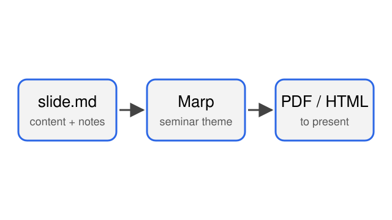

<!-- _class: title cover -->
<!-- _paginate: skip -->

# Sample Presentation

## A Tour of the Seminar Theme

Your Name

Your Laboratory · Seminar

Title of the Paper You Introduce with a Highlighted Keyword

A. Author &amp; B. Author · arXiv:0000.00000

<!--
English script:
This is a sample deck. Each page shows one feature of the shared seminar theme.

Japanese notes:
このファイルは新しい発表のひな形を兼ねた見本。各ページでテーマの機能を1つずつ紹介しているので、使わないページは消して書き換える。
表紙。論文紹介なら paper-card に論文名・著者を入れる。不要なら div ごと消す。
原稿（English script）とメモ（Japanese notes）はこのコメント内に書くと、スライドには表示されず発表者ノートになる。
-->

---

# Bullet Points and Sources

- A slide is separated by a line containing only `---`
- **Bold** and *italic* work as usual
  - Nested items are indented by two spaces
- Put the citation at the bottom right with a `source` div

[1] §2, Theorem 1

<!--
English script:
Write the main points as short bullets.

Japanese notes:
出典は右下に小さく出る。論文のどこから取ったかを毎ページ書いておくと質疑で困らない。
-->

---
<!-- _class: section -->

# Part 1: Layouts

---

# Two-Column Layout

- Left column: 40%
- `left-40` … `left-70`
- `gap-small` / `gap-large`

Figure: made for this template

<!--
Japanese notes:
HTMLの div と Markdown の間には必ず空行を入れる（入れないとMarkdownとして解釈されない）。
画像は figure/ に置き、出典を figure/README.md に書く。
-->

---

# Equations

The time-ordered evolution operator:

$$U(T)=\mathcal T\exp\!\left[-i\int_0^T H(t)\,dt\right]$$

Inline math also works: $\Delta t = T/N$.

---
<!-- _class: small-text -->

# Tables and Small Text

`small-text` shrinks every font size on this page.

| Class | Use |
|---|---|
| `title cover` | Cover page |
| `section` | Section divider |
| `no-header` | No top header |
| `small-text` | Dense pages |
| `refs` | References |

---
<!-- _class: refs -->

# References

[1] A. Author and B. Author. *Title of the Paper You Introduce.* arXiv:0000.00000, 2026.
