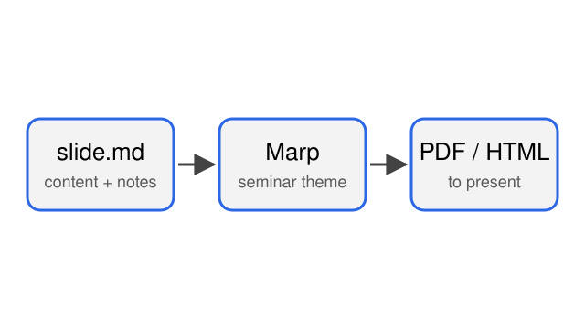

<!-- _class: title cover -->
<!-- _paginate: skip -->

# Sample Presentation

## A Tour of the Seminar Theme

Your Name

Your Laboratory · Seminar

Title of the Paper You Introduce with a Highlighted Keyword

A. Author &amp; B. Author · arXiv:0000.00000

<!--
English script:
This is a sample deck. Each page shows one feature of the shared seminar theme.

Japanese notes:
このファイルは新しい発表のひな形を兼ねた見本。各ページでテーマの機能を1つずつ紹介しているので、使わないページは消して書き換える。
表紙。論文紹介なら paper-card に論文名・著者を入れる。不要なら div ごと消す。
原稿（English script）とメモ（Japanese notes）はこのコメント内に書くと、スライドには表示されず発表者ノートになる。
-->

---
<!-- _class: outline -->

# Outline

1. Basics
2. Layouts
3. Emphasis

<!--
Japanese notes:
目次のページ（outline）。3章以上ある、またはおよそ15枚を超える発表で使う。短い進捗報告では付けない。
各章の頭の章扉に同じ箇条書きを写し、今の章だけを **…** で囲む（ほかの章は自動で薄くなる）。
-->

---
<!-- _class: outline -->
<!-- header: 1. Basics -->

# Outline

1. **Basics**
2. Layouts
3. Emphasis

<!--
Japanese notes:
章扉は目次と同じページ（outline）で、同じタイトルと箇条書きのまま、今の章だけを **…** にする。章が進むと強調だけが移って見える。
章扉の先頭の header: 1. Basics の行（HTML コメントで書く）で、その章のページの左下（ページ番号の右）に章の名前が出る。最後の参考文献のページで header を空にして消す。
-->

---

# Bullet Points and Sources

- A slide is separated by a line containing only `---`
- **Bold** and *italic* work as usual
  - Nested items are indented by two spaces
- Put the citation at the bottom right with a `source` div

[1] §2, Theorem 1

<!--
English script:
Write the main points as short bullets.

Japanese notes:
出典は右下に小さく出る。論文のどこから取ったかを毎ページ書いておくと質疑で困らない。
-->

---

# Equations

The time-ordered evolution operator:

$$U(T)=\mathcal T\exp\!\left[-i\int_0^T H(t)\,dt\right]$$

Inline math also works: $\Delta t = T/N$.

---
<!-- _class: outline -->
<!-- header: 2. Layouts -->

# Outline

1. Basics
2. **Layouts**
3. Emphasis

---

# Two-Column Layout

- Left column: 40%
- `left-40` … `left-70`
- `gap-small` / `gap-large`

Figure: made for this template

<!--
Japanese notes:
HTMLの div と Markdown の間には必ず空行を入れる（入れないとMarkdownとして解釈されない）。
画像は figure/ に置き、出典を figure/README.md に書く。
-->

---
<!-- _class: small-text -->

# Tables and Small Text

`small-text` shrinks every font size on this page.

| Class | Use |
|---|---|
| `title cover` | Cover page |
| `outline` | Table of contents |
| `section` | Section divider without an outline |
| `no-header` | No top header |
| `small-text` | Dense pages |
| `refs` | References |

---
<!-- _class: outline -->
<!-- header: 3. Emphasis -->

# Outline

1. Basics
2. Layouts
3. **Emphasis**

---

# Emphasis: Bold and Accent

- **Setting:** the same oracle and the same target error for both methods
- **Result:** the new method needs 53% fewer queries at $T=64$

<!--
Japanese notes:
強調は DESIGN.md の4章のとおり。太字は項目の頭の見出し語、青い文字（accent）は1枚に1〜2か所。
1枚に使う強調は2種類まで。
-->

---

# Emphasis: Box

Both methods use the same oracle and the same target error.

Theorem 1. The query count is $O(\alpha T + \log(1/\varepsilon))$, which matches the known lower bound.

<!--
Japanese notes:
囲み枠（box）は結論・定理・定義を1つだけ。囲み枠と淡い背景（panel）は同じ1枚で両方使わない。
-->

---

# Emphasis: Panel

**Previous approach**

- Splits time into $r$ steps
- Error grows with the step size

**This work**

- Uses one transducer per step
- Error is fixed by the query budget

<!--
Japanese notes:
淡い背景（panel）は、まとまりを1つの面にまとめるときに1つだけ使う。ここでは比べる2案のうち、主役の側だけに付けている。
-->

---
<!-- _class: refs -->
<!-- header: "" -->

# References

[1] A. Author and B. Author. *Title of the Paper You Introduce.* arXiv:0000.00000, 2026.
